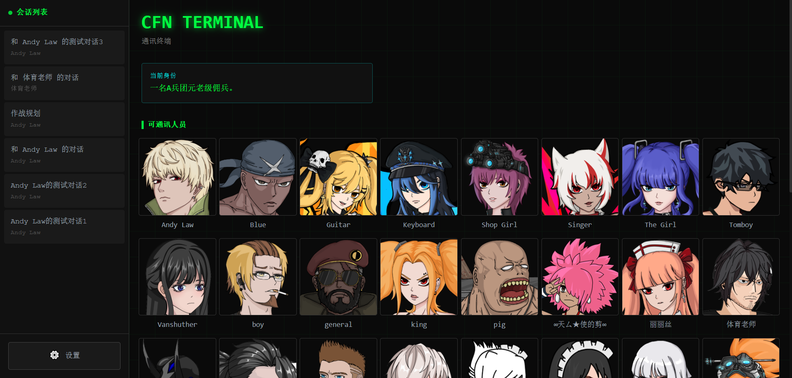

# CFN Terminal

一个与游戏 NPC 进行沉浸式对话的前端终端界面，配合 RAG + Agent 检索后端实现智能 NPC 交互。


## 功能特性

- **沉浸式终端界面** - 赛博朋克风格的聊天界面，支持 NPC 头像与动态立绘展示
- **智能 NPC 对话** - 基于 RAG 检索增强的 NPC 回复，提供上下文感知的交互体验；支持**流式回复**（打字机效果）
- **动作与情绪** - 可输入动作/心理描写，消息中 `【】` 内内容以动作样式展示；支持情绪继承与 NPC 情绪立绘切换
- **好感度系统** - 实时显示 NPC 好感度变化与关系等级，可查询指定 NPC 的好感度接口
- **会话管理** - 多会话并行、切换；支持**删除会话**、**重命名会话**
- **立绘展示** - 立绘布局模式（全局居中 / 右侧对齐 / 右侧居中），支持拖动微调位置
- **角色设定** - 可配置玩家身份（性别、游戏进度等），影响 NPC 对话内容
- **AI 模型与代理** - 自定义 API Key、Base URL、模型名称；可选填代理服务器地址以访问 AI 服务
- **Agent 后台工作与系统通知** - 流式回复期间可展示后端同步工具进度（`tool_status`）与后台子 Agent 工作进度（`agent_status`，如「准备候选中」「拟定委托中」「查资料中」），任务草案/发布等系统消息以居中提示展示（`system_notice`）
- **知识库** - 设置内可重置知识库（重新生成向量库）；立绘由游戏对话立绘资源体系提供，无需手动生成

## 技术栈

- **前端框架**: Vue 3 + TypeScript + Vite
- **状态管理**: Pinia
- **样式方案**: Tailwind CSS
- **HTTP 客户端**: Axios

## 快速开始

### 环境要求

- Node.js >= 18
- npm 或 yarn

### 安装依赖

```bash
npm install
```

### 开发模式

```bash
npm run dev
```

开发时前端会将 `/api` 代理到 `http://127.0.0.1:7077`（可在 `vite.config.ts` 中修改），立绘导出等长耗时请求已配置较长超时。

### 构建生产版本

```bash
npm run build
```

## 后端对接

本项目前端默认配套的后端实现为 **CrazyFlashNight** 项目（闪客快打7重置版服务端与工具集），代码仓库地址见：[FlashNightModReborn/CrazyFlashNight](https://github.com/FlashNightModReborn/CrazyFlashNight)。

本项目需要配合 RAG 检索后端使用，后端需提供以下 API：

**会话与对话**

- `GET /api/game/sessions` - 获取会话列表和 NPC 候选
- `POST /api/game/sessions` - 创建新会话
- `DELETE /api/game/sessions/:sessionId` - 删除会话
- `PUT /api/game/sessions/:sessionId/title` - 重命名会话（请求体 `{ "title": "新标题" }`）
- `GET /api/game/history/:sessionId` - 获取会话历史记录
- `POST /api/game/ask` - 发送消息并获取 NPC 回复（非流式）
- `POST /api/game/ask?stream=true` - 流式发送消息（SSE：`meta` / `content` / `tool_status` / `agent_status` / `system_notice` / `done` / `error` 事件）

**Ask 请求体补充**：`agent_enabled`（boolean，可选，前端默认 `true`）— 关闭时后端不下发任何路由工具、提示词也不提任务发布，NPC 只聊天；`summarize_interval`（10/30/100/500，默认 30）— 精确短期记忆的对话条数档位。

### SSE 事件约定（/api/game/ask?stream=true）

后端以 Server-Sent Events 推送多类事件，前端按 `event:` 分发解析（权威定义见后端仓 `docs/v3-developer/09-前端适配说明.md`）：

- **meta**：`data: { emotion, favorability_change, favorability, relationship_level }`  
  每回合**有且仅有一次，且必先于一切 content**；收到即切立绘、更新好感度条。
- **content**：`data: { "delta": "..." }`  
  打字机增量，按顺序拼接为最终回复；只含 NPC 台词（其中 `【...】` 仍按动作描写解析渲染），不再有 `{花括号}` 系统文本。
- **tool_status**：`data: { tool, status, ui_hint }`  
  后端同步工具进度（发布/取消委托等），`status ∈ running/success/failed`。前端展示 `ui_hint`（≤12 字，缺失时回退 `tool`），`failed` 时清除等待占位。
- **agent_status**：`data: { agent, phase, ui_hint }`  
  后台子 Agent 进度，`agent ∈ task/search`，`phase ∈ drafting/repairing/searching/done/failed`。以状态占位气泡展示（`ui_hint` 如「准备候选中」「拟定委托中」「查资料中」），`done`/`failed` 后清除占位。
- **system_notice**：`data: { "text": "..." }`  
  系统消息（任务草案已拟定/委托已发布/草案过期取消/错误说明），按**居中系统通知样式**单独成行渲染。
- **done**：`data: { session_id, usage?: { prompt_tokens, completion_tokens, cached_tokens } }`  
  回合结束标记。v3 的 done **不再携带** `reply`/`favorability` 等整包字段，回复文本一律以流式 `content` 为准（旧版用 `data.reply` 覆盖流式文本会导致气泡先显示后消失）。
- **error**：`data: { code, message, retryable }`  
  不可恢复错误；`retryable=false` 时提示用户检查模型配置。
- 另有 SSE 注释帧 `: keep-alive`（无 `event:` 名），是等待后台子 Agent 时的保活帧，按规范跳过 `:` 开头的行即可。

**等待期的气泡行为**：`meta` 之后可能先出现一段静默期（NPC 决定把活派给后台 Agent 时，那一轮不说话）。前端用「初始占位 → 状态占位 → 首段正文」的同一气泡原地演进处理：占位文本先显示 `tool_status`/`agent_status` 的 `ui_hint`，第一段 `content` 到达时替换占位文本并退出占位态；若占位已被封口，则另起新气泡。

**NPC 与资源**

- `GET /api/game/npc/:npcName/favorability` - 获取指定 NPC 的好感度与关系等级
- `GET /api/assets/avatar/:npcName` - 获取 NPC 头像
- `GET /api/assets/illustration/:npcName/:emotion` - 获取 NPC 立绘（按游戏对话立绘 manifest 查表，返回源 PNG，裁剪/取景由前端负责）

**知识库**

- `POST /api/game/knowledge-base/reset` - 重置知识库（强制重新生成向量库）

## 配置说明

首次使用需在设置面板中配置：

- **玩家身份** - 设置性别和游戏进度，影响 NPC 对你的称呼和对话内容
- **AI 模型** - 配置 API Key、Base URL 和模型名称（如 OpenAI、Claude 等）
- **代理服务器** - 可选；若需通过代理访问 AI 服务，可填写代理地址，留空则使用系统代理或不使用代理
- **Agent 能力** - 默认开启；关闭后后端既不下发路由工具、提示词也不提任务发布，NPC 只聊天（不能派发/确认/取消委托、不代查资料），调用次数与 token 随之下降
- **精确短期记忆长度** - 逐字带入上下文的最近对话条数（10/30/100/500，默认 30）；会话另有不受此项影响的永久模糊记忆（滚动摘要）。档位越大越吃模型上下文窗口，token 消耗也越高
- **重置知识库** - 可强制后端重新生成向量库（如文档或设定变更后）
- 立绘无需在此管理：NPC 立绘由游戏项目的对话立绘资源体系提供，后端按 manifest 查表直出

## 前端使用说明（用户操作指南）

本节面向最终用户，介绍界面功能、操作步骤与注意事项。

### 首次使用前

1. **完成佣兵档案配置**  
   首次打开页面会提示「请先完成佣兵档案配置」。点击 **设置**（左下角）或 **立即配置**，在「佣兵档案配置」中填写：
   - **性别**、**当前进度**（必填），可选填「一句话介绍」（最多 30 字），用于 NPC 对你的称呼与对话内容。
   - **系统配置**：模型名称、API Base、API Key；若需走代理访问 AI，填写「代理服务器地址」；可在「Agent 能力」中关闭 Agent 以降低调用与 token（默认开启）。
   - 保存后即可在首页看到「当前身份」预览；未配置时首页会持续提示配置。

### 主界面与会话

- **首页（通讯终端）**  
  左侧为会话列表，右侧为主区域。未选中任何会话时，主区域显示 **可通讯人员**（NPC 列表），点击某个 NPC 头像即可新建与该 NPC 的会话。

- **新建会话**  
  点击 NPC 后弹出「新建会话」弹窗，需输入 **会话标题**（必填，如「和 XXX 的对话」），确认后创建并自动进入该会话。

- **切换会话**  
  在左侧会话列表中点击任意会话即可切换；当前会话会高亮显示（绿色边框）。

- **返回首页**  
  在聊天面板头部点击 **← 返回** 可退出当前会话回到 NPC 列表，不会关闭或删除会话。

- **会话操作（重命名 / 删除）**  
  在会话列表项上 **悬停**，右侧会出现「三点」菜单按钮，点击后可选择：
  - **重命名**：修改该会话的标题（新标识符最多 35 字）。
  - **删除**：删除该会话（通常会有二次确认），**删除后不可恢复**，请谨慎操作。

### 对话与输入

- **发送消息**  
  在底部输入框输入文字（最多 500 字，接近 300 字时会显示字数），按 **Enter** 或点击 **发送** 即可。NPC 回复为**流式输出**（打字机效果），回复过程中请勿重复发送。

- **动作 / 心理描写**  
  输入框上方有一条可展开的 **动作条**（点击左侧小箭头展开/收起）。在动作条中输入的内容会作为「动作」随本条消息一起发送；在**消息正文**中，用 **【】** 包裹的内容也会以动作样式显示（如 `【微微一笑】`）。动作条内容最多 250 字。

- **加载更早消息**  
  在聊天区域顶部有「加载更早消息」按钮，可向上加载该会话的更多历史记录。

### 好感度与立绘

- **好感度**  
  在聊天面板头部会显示当前 NPC 的 **好感度** 与 **关系等级**；好感度变化时会有短暂的增减飘字提示。

- **立绘布局**  
  当该 NPC 有立绘时，聊天区域右上角会出现三个布局模式按钮（仅在有立绘时显示）：
  - **全局居中**：立绘在整体画面居中。
  - **右侧对齐**：立绘贴右侧展开。
  - **右侧居中**：立绘在右侧约 300px 区域内垂直居中（默认）。  
  切换模式会重置立绘的手动偏移。

- **立绘位置微调**  
  在「右侧对齐」或「右侧居中」模式下，可在立绘区域（右侧约 300×600 区域）内 **按住鼠标拖动** 微调立绘上下位置；再次点击布局按钮会清除本次拖动偏移。

- **情绪与立绘**  
  NPC 回复中若带有情绪信息，立绘会随情绪切换；若某情绪无立绘资源，则可能不显示或沿用上一帧。

### 设置面板（佣兵档案与系统）

通过左下角 **设置** 进入，包含：

- **佣兵档案**：性别、当前进度、一句话介绍（影响 NPC 对话与称呼）。
- **系统配置**：模型名称、API Base、API Key；可选「记住 API Key」（会写入本地存储，公共电脑慎用）；代理服务器地址。
- **Agent 能力**：默认开启。关闭后 NPC 只聊天，不再派发/确认/取消委托，也不代查资料；调用次数与 token 随之下降。
- **精确短期记忆长度**：逐字带入上下文的最近对话条数（10/30/100/500，默认 30）。会话另有不受此项影响的永久模糊记忆（滚动摘要），此项只决定「精确」那一段有多长；档位越大越吃模型上下文窗口，token 消耗也越高。
- **重置知识库**：强制后端重新生成向量库（例如文档或设定更新后使用）。系统会提示「正在重置知识库，请稍候…」。

NPC 立绘由游戏项目的对话立绘资源体系提供，设置面板不再有需要手动生成/导出立绘的按钮。

**注意事项：**

- API Key 若勾选「记住」会保存在浏览器本地，在公共设备上建议不勾选。
- 知识库重置可能耗时较长且对设备占用较高，请勿在未完成前关闭页面或重复点击；非特殊情况下无需重置。

### 其他说明

- 若「可通讯人员」列表为空，请确认后端已启动且会话/NPC 接口正常；若某 NPC 头像加载失败，该 NPC 可能不会出现在列表中。
- 创建会话或发送消息失败时，请检查网络、后端是否可用，以及是否已正确配置 API Key（或后端 .env）。

## 预览



## License

[MIT](LICENSE)
